

  

<h1 align="center">Duel Lens</h1>

  <b>Point at any Yu-Gi-Oh! card in a duel video, a stream, a deck list or any page, and read it right there.</b> 
  Turn on Live check and rest the pointer on a card: its full text appears beside it while the video plays. Or press a
  shortcut to scan the whole page.

  
  

  

Duel Lens is an unofficial fan tool, not affiliated with or endorsed by Konami.

The clips in this README are recorded from the real extension, on a made-up duel (no broadcast footage).

## What it does

- **Live check: point at a card, anywhere.** Turn it on once, then rest the pointer on a card in a video (playing
  or paused) or a picture, and its box opens beside it. Move to the next card and the box follows. The cards it is
  sure of are listed in the side panel, with the moment in the video.
- **Reads the cards on your screen, not only in videos:** YouTube duels, tournament streams, VODs, deck lists,
  pictures and screenshots, on any page.
- **Shows the card right there:** its official picture, type, Attribute, Level, ATK/DEF, banlist status
  (TCG or OCG, with the marks players know and a coloured frame around the picture), Genesys points, market prices
  and the full card text. No new tab, no search.
- **Or scan the whole page:** a shortcut freezes the frame and outlines every card in gold. Rest on a card for its
  details, click to keep it, then the next one: Duel Lens stays open until you're done. Or draw a box around any
  card.
- **Tells you when it isn't sure,** and lets you flip through the closest matches.
- **Finds a card by name,** no scan needed: type a few letters in the side panel, or press **/** while
  scanning.
- **Lets you report a wrong card:** **Report issue** sends that read to Duel Lens's public issue tracker,
  with no account needed, so it can be fixed.
- **Remembers the cards you scanned** in Chrome's side panel, with the moment in the video.
- **Speaks your language:** English, French, German, Italian, Spanish, Japanese, Korean, Brazilian Portuguese or
  Simplified Chinese, following your browser or chosen in Options; card names and text in another official card
  language too.
- **Recognition runs on your computer,** on your graphics card when your browser has one it can use
  (about twice as fast), or on its processor otherwise. No account, no analytics, free. An optional AI
  check uses your own Anthropic key.

## Install

Install it from your browser's store: it updates itself.

**Chrome Web Store:** [install Duel Lens](https://chromewebstore.google.com/detail/cigbnalidhajeoancmafhnobolodeoei)
(Chrome, Brave, Vivaldi and other Chromium browsers).

**Firefox Add-ons:** [install Duel Lens](https://addons.mozilla.org/firefox/addon/duel-lens/) (Firefox 140 or newer).

**Opera and Microsoft Edge:** Opera's add-on store is reviewing it, and Edge's listing is on its way. Until
then, both can install it from the Chrome Web Store: in Edge, allow extensions from other stores when it
asks; in Opera, add Opera's "Install Chrome Extensions" first.

**Manual install,** from a release zip. Only if you can't use a store: a manual install doesn't update itself.

1. Download `duel-lens-<version>.zip` from the [latest release](https://github.com/mathulbrich/duel-lens/releases/latest) and unzip it into a folder
   you'll keep (Chrome loads the extension from there).
2. Open `chrome://extensions` and turn on **Developer mode** (top right).
3. Click **Load unpacked** and pick the unzipped folder.
4. Optional: pin Duel Lens to the toolbar (the puzzle-piece icon, then the pin).

Each release zip is built by GitHub from its tag, and signed with where it came from. To check a download, with
the [GitHub CLI](https://cli.github.com/): `gh attestation verify duel-lens-<version>.zip -R mathulbrich/duel-lens`.

It needs Chrome 124 or newer. When a new version is out, Duel Lens says so in its side panel and Options
(it asks GitHub once a day; Options can turn this off). To update a manual install and keep your history and
settings:

1. Download the new `duel-lens-<version>.zip` from the [latest release](https://github.com/mathulbrich/duel-lens/releases/latest).
2. Unzip it **into the same folder**, replacing the old files. A new folder is a new extension to the browser:
   it starts without your history and settings.
3. In `chrome://extensions`, click the reload icon (↻) on Duel Lens's card.

To switch to the store version instead, install it from the store, then remove the manual one (the two don't
share their history).

**In Firefox:**
- the side panel is Firefox's sidebar. **Alt+Shift+U** opens it; **S** and **Keep in side panel** open it in a small window instead, because Firefox opens its sidebar only from a shortcut or a button;
- scans take about 0.3 to 0.7 s instead of about 0.15 s, since Firefox gives extensions fewer processor threads;
- after 30 s without a scan, the next one takes about 0.4 s longer while Firefox reloads the engine.

**First run: Duel Lens asks for your OK.** Its welcome page opens when you install it. Read what it
handles and press **Agree and start**. Until you do, the shortcut opens this step instead of scanning,
and **Not now** keeps scans off.

  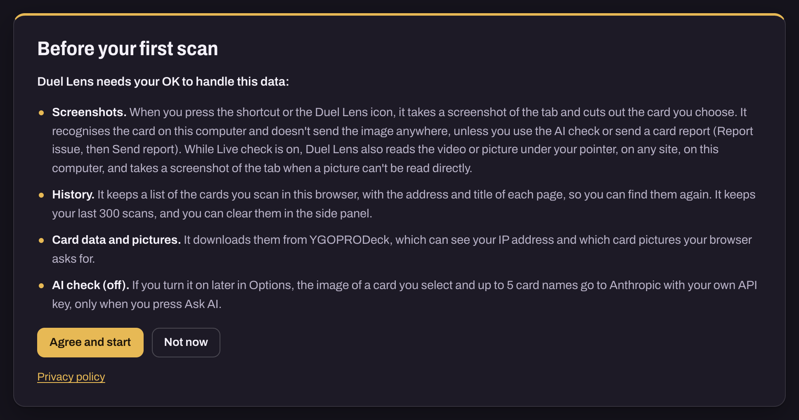

## How to use it

**Live check,** while the video plays:

1. **Click the Duel Lens icon** in the toolbar and turn on **Live check** (or press **Alt+Shift+L**, Mac: ⌥⇧L). The
   first time, your browser asks for access to every site, so Duel Lens can work on any page.
2. **Rest the pointer on a card** in a video or a picture. Its box opens beside it: "reading" for a moment, then the
   card in full. **Move to the next card** and its box follows.
3. **Click the box** to keep it open; **Esc** or its **✕** closes it. The cards Live check is sure of are listed in
   the side panel's **Live check** tab.

**Scan,** to freeze the moment and read every card:

1. **Press Alt+Shift+Y** (on a Mac, Option+Shift+Y, shown as ⌥⇧Y), or **Scan this page** in the toolbar icon's
   popup. The picture freezes, the video pauses, and every face-up card on it gets a gold outline.
2. **Rest the pointer on a card** to see its details; **click it** (or drag a box around it) to keep it, in the card
   box beside the card. **Click another card** to read that one: Duel Lens stays open.
3. **Esc** closes the card. Press **Esc** again, or the **✕** on the bar at the top, to leave; **Space**
   or **K** resumes the video.

Another extension may already use Alt+Shift+Y; then Duel Lens's shortcut shows as "Not set". Pick any
keys you like at `chrome://extensions/shortcuts` (the toolbar icon always works too).

## Features

### Live check: point at any card, anywhere

Click the Duel Lens toolbar icon and turn on **Live check** (or press **Alt+Shift+L**, Mac: ⌥⇧L, or tick it in the
icon's right-click menu). The first time, your browser asks for access to every site, so Duel Lens can work on any
page. Then just point:

- **In a video** (playing or paused), rest the pointer on a card and its box shows: "reading" for a moment, then
  the card. Gold outlines mark the cards Live check found, and a small **LIVE CHECK** label at the video's corner
  counts the cards it listed (its **✕** stops Live check there). Duel Lens reads the card under the pointer
  first and the others ahead of you, and lists the ones it is sure of in the side panel's **Live check** tab (click a
  row to go back to that moment). Cards cut off at the bottom of the picture, like a hand, are read whole, and a hand card that
  the next one covers is read from the part that shows.
- **In a picture** (a deck list, an image, a drawing on the page, an embedded player), rest the pointer on a card
  for a moment and its box shows.

  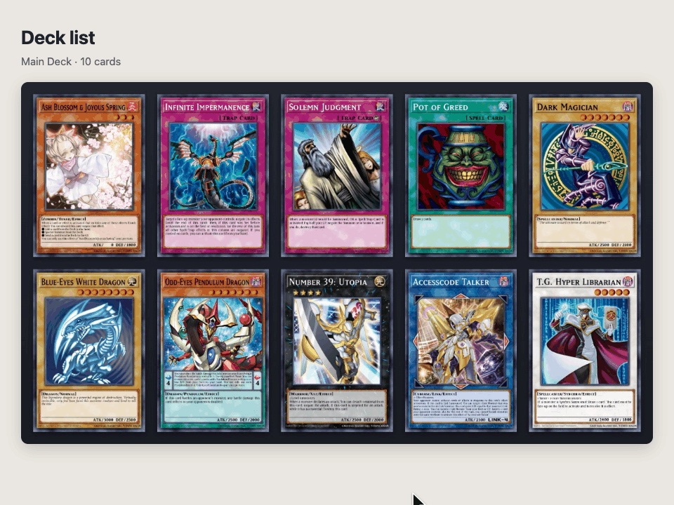

The popup's **Speed** has three dots: **Light** (the default: a smaller, faster reader for older computers),
**Balanced** and **Best** (every check on each card, for fast computers). Options has the same choice, **Show the LIVE
label on the video**, and **Card text** (text size and box width, with a preview). The models load when you turn
Live check on and stay loaded while it is on; until then the label on the video says **getting ready**.

Privacy: Live check reads only where the pointer rests, on your computer. In a video, a tiny grey thumbnail about 5
times a second notices changes, and a frame and card crops are read when a card settles. On a picture, it reads the
picture's own pixels when the page allows it, otherwise a screenshot of the visible part of the tab (only the tab you
are looking at). They stay in memory and are dropped once read; nothing is sent anywhere. The card box loads the
card's details and picture as a scan does.

### What the card box shows

  

- **The card:** its official picture, name and type. **Click the picture** to see it bigger, across the box;
  click again, **Esc** or **✕** shrinks it.
- **Its facts, drawn as the card draws them:** the Attribute's icon with its kanji (闇 DARK, 光 LIGHT, 炎 FIRE…), a
  star with the Level (an outlined one for Rank), a Link monster's arrows as a small grid, the Pendulum Scale, then
  ATK and DEF.
- **Banlist status,** with the marks players know: a circled 1 for Limited, a circled 2 for Semi-Limited, a
  crossed circle for Forbidden, and a frame around the picture in the same colour (orange, yellow or red). Shows
  the TCG's list by default, or the OCG's (Options → Banlist; a new install in a Japanese, Korean or Chinese
  browser starts on the OCG's). Nothing shows for a card unlimited on the chosen list.
- **Genesys points,** in a hexagon: what the card costs in the Genesys format. Only cards that cost points show
  them.
- **Market prices:** TCGplayer (USD) and Cardmarket (EUR), with the date they're from. Informational
  only — there's no buying link. Nothing shows for a card with no price quoted.
- **The full text,** with a Pendulum card's two effects apart. Below it, one line: the **passcode**, the
  **archetype** and the **price**, then links to the card's page on Konami's own database and on YGOPRODeck.
- **Card text language:** the name and text in French, German, Italian, Portuguese, Japanese or Korean
  instead of English (Options → Card text language). Duel Lens downloads that language's card text once
  from YGOPRODeck (about 3 MB) and keeps it on your computer. The English name stays under the translated
  one, a card without a translation shows in English, and Ask AI still works in English.
- **How close the match is:** when Duel Lens isn't sure, the "Not sure" line's tooltip says how similar the artwork looks, as a percentage. It isn't a probability.
- **Keep in side panel** (or **S**): keep it (below). **Wrong card?** finds the right one by name, and the flag
  reports a wrong card. The **YGOPRODeck** link opens its page on [YGOPRODeck](https://ygoprodeck.com/), where Duel
  Lens's card data and pictures come from.
- **Card text** size and the box's width: Options → Card text (Small by default, with a preview).

The picture is the card's official image from YGOPRODeck, downloaded the first time Duel Lens shows that
card and then cached on your computer.

### Scan: click a card

After the shortcut, Duel Lens finds every face-up card on the frozen frame and outlines it in gold;
the rest of the picture dims. Click a card to read it, then click the next one: its details replace the
first card's. Duel Lens stays open until you leave, so one press of the
shortcut is enough for the whole board. Cards lying sideways, upside down or tilted are outlined as they
lie. Face-down cards, sleeves and deck piles get no outline: there's nothing on them to read.

A small bar at the top of the page says how many cards are outlined, with a **✕** to leave. A click on
an empty part of the picture closes the card you're reading and keeps the outlines.

Prefer the keyboard? **Tab** / **Shift+Tab** or the arrow keys step through the outlined cards, and
**Enter** reads the one in focus.

  

### Card details on hover

Rest the pointer on an outlined card for a moment, and its card box opens beside it: the card and its text.
Move to the next card and the box follows; click it to keep it, with its passcode, price, links and buttons, and
the card in your history. With the keyboard, the card in focus shows its box too.

  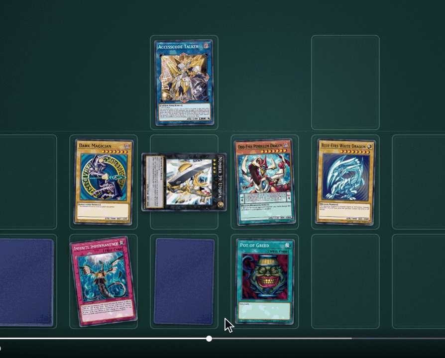

- **When Duel Lens isn't sure,** the box says so, with its best guess; a click shows the other matches.
- **A look is only a look.** It isn't saved to your history and never uses the AI check: only the cards
  you click (or box) are.
- **Esc** hides it. You can move the pointer onto it to read it, and a click on it keeps the card.
- **More, or less, on hover?** In Duel Lens's Options, **Show card details** has three choices: **Full details
  on hover** (the default), **Quick preview on hover** (a small preview: name, type and ATK/DEF), and **Click**,
  where nothing shows until you click.

### Drag a box, or click two corners

Drag a box around any card: the whole card, or just its artwork. It works on a card without an outline
too, and before the outlines appear.

  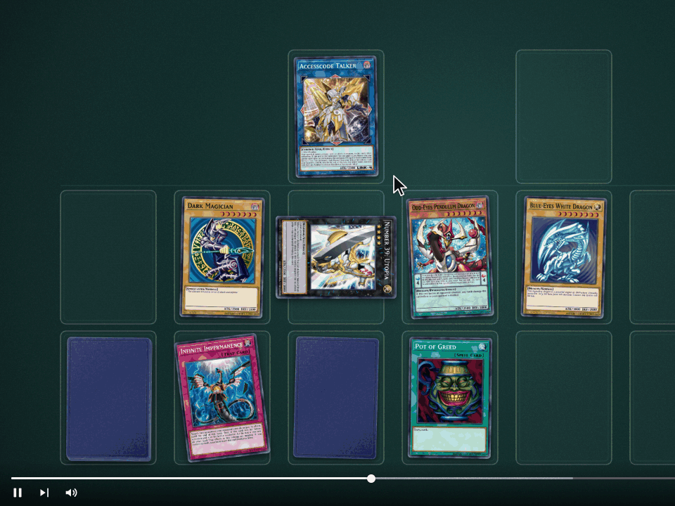

Rather not drag? Click beside the card, where nothing is outlined, to set one corner; a box follows the
pointer; click the opposite corner to read it. **Esc**, or a click back on the first corner, drops the
corner. While a card's details are open, that first click only closes them: click again to set the
corner.

  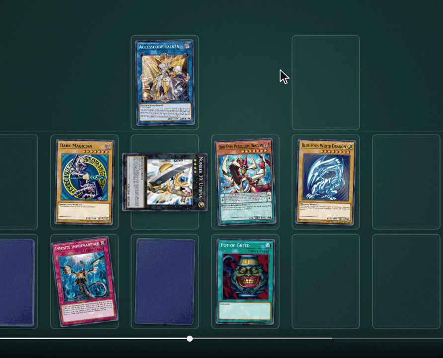

### "Not sure" and other matches

When the match isn't clear enough to call (motion blur, glare, a small or low-quality card), the card box
says **Not sure** and shows its best guess, with up to three other close matches under "Could also be".
Press **→** / **←** to step through them, or click one. Picking one also fixes that scan in your history.
A confident answer lists any close look-alikes too, under "Not it?".

When the match is weaker still but Duel Lens can see there's a card there (you clicked its outline, or
your box holds one), it doesn't give up: it shows its closest guesses under **Low match: this could be
it** (or "could be one of these"). Treat those as hints, not answers. Online duel simulators that print a
pile count over the top card, such as DuelingBook's "1", get a second try with the number painted out.

  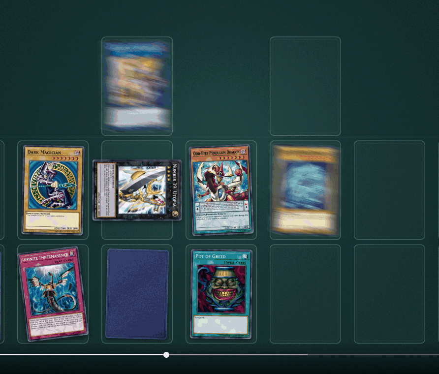

### Report a wrong card

When Duel Lens names the wrong card, isn't sure, or finds nothing, press the flag (**Report issue**) at the
bottom of the card box. Before anything goes, it lists what the report holds:

- the card's picture (made smaller), the card it showed and the other matches it offered;
- the right card, if you know it: optional, and you can find it by name right there in the report;
- the video's link and time on YouTube; on another page, its address without the part after "?" or "#";
- your comment, if you write one (up to 500 characters);
- Duel Lens's version, your browser and your system.

Nothing is sent until you press **Send report**. The report becomes a public issue on
[Duel Lens's issue tracker](https://github.com/mathulbrich/duel-lens/issues), opened by the "Duel Lens
Reports" app: you don't need a GitHub account. Everything in it is public, so don't write anything
personal. The report service keeps the picture 90 days, for the issue, and doesn't keep your IP address.

In Firefox, allow it once first: Options → **Card reports** → **Allow card reports**. Each person can send
2 reports a minute, and there's a daily limit for everyone.

### Keep it in the side panel

Press **S** (or **Keep in side panel**) to open Chrome's side panel on the card: its picture in full,
all its details and text, and below, **This session**: the cards you scanned, each with its time (for a
video, the moment in the video). On YouTube, that time is a link back to the moment. Click an entry to
see its card again; **Clear history** empties the list. **Alt+Shift+U** opens the panel at any time.
While it's open, each card you click shows there in full too.

  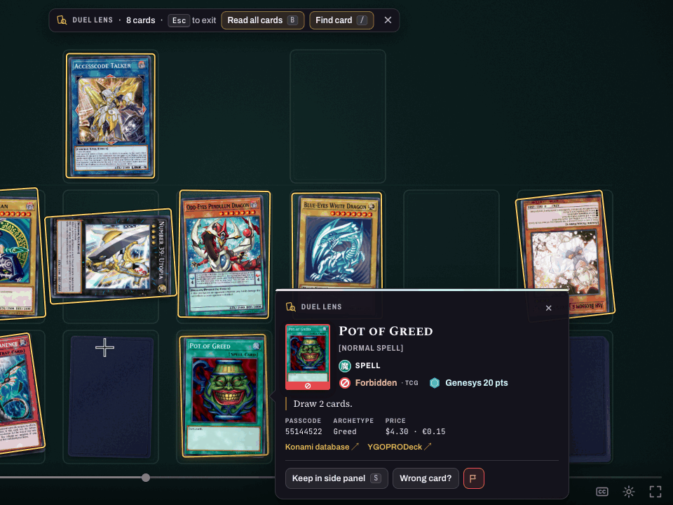

The history keeps your last 300 scans, in this browser only. A preview isn't a scan: only the cards you
click or box are kept.

### Find a card by name

Want a card's text without scanning it? Look it up by name.

- **In the side panel:** type in the **Find a card by name** box at the top. From two letters on, the
  matches come from the card list on your computer, each with its type (nothing goes online while you
  type). **↓** moves to the matches, **Enter** opens one in full, with its picture, and **Esc** goes back.
  A card you look up isn't added to your history.
- **From anywhere:** press **Alt+Shift+F** (Mac: ⌥⇧F), or right-click the Duel Lens icon in the toolbar
  and choose **Find a card by name…**. The side panel opens on that box.
- **While scanning:** press **/**, or **Find card** on the bar. A search opens under the bar (above it,
  when the bar is at the bottom), and the card you pick shows in the card box, marked "Found by name".
- **When a scan finds nothing:** the card box offers **Find card**. The card you pick shows, and is saved
  to your history as the right answer for that scan.

### Keyboard shortcuts

| Key | What it does |
|---|---|
| **Alt+Shift+Y** (Mac: ⌥⇧Y) | Scan: freeze the picture and outline the cards. Pressed again, it leaves |
| **Tab** / **Shift+Tab**, arrow keys | Step through the outlined cards (unless **Show card details** is **Click**, the one in focus shows its preview) |
| **Enter** | Read the outlined card in focus |
| **B** | Read the whole board: every outlined card, one at a time. Esc or Stop ends it early |
| **←** / **→** | Show the other matches |
| **/** | Find a card by name, right there: a search opens under the bar, and the card you pick shows in its card box |
| **S** | Keep in side panel: open the side panel on this card |
| **Esc** | Shrink the card's bigger picture first, then close an open search or report, then the card's details, or its preview; with nothing open, leave Duel Lens (a right-click on the picture leaves too) |
| **Space** or **K** | Leave Duel Lens and resume the video (Space on a button you reached with Tab presses it) |
| **Alt+Shift+U** (Mac: ⌥⇧U) | Open the side panel |
| **Alt+Shift+F** (Mac: ⌥⇧F) | Find a card by name: the side panel opens on its search box |
| **Alt+Shift+L** (Mac: ⌥⇧L) | Turn Live check on or off |

While Duel Lens is open, these keys go to Duel Lens, not to the page, so YouTube won't turn on captions
or skip under it; Space and K, YouTube's own play keys, leave Duel Lens and resume the video. While you
type in one of Duel Lens's boxes (**Wrong card?**, **Find card**, a report's comment), the keys stay in the
box: Space, K, F and the arrows don't reach YouTube or Duel Lens's shortcuts, and **Tab** stays inside
Duel Lens. Change the four shortcuts at `chrome://extensions/shortcuts`.

### Scanning: the video waits for you

While Duel Lens is open, the video on the page pauses: the frozen frame is a picture of the moment you
pressed the shortcut, so nothing runs on underneath. When you leave, it plays again, unless you had
paused it yourself. To leave, press **Esc** (twice if a card is open), click the **✕** on the bar at the
top, or press the shortcut again; **Space** or **K** resumes the video. Resizing the window or switching
fullscreen leaves too, since the frozen frame would no longer match the page.

  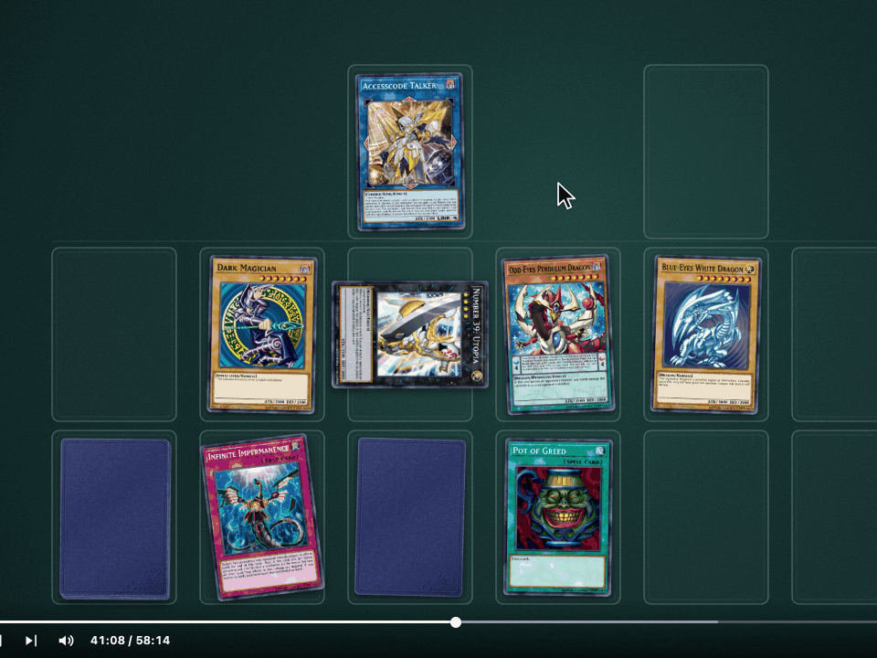

### Cards cut off at the edge

If a card runs off the edge of the picture and the normal match finds nothing, Duel Lens tries once more
and completes the missing part. At best that gives a **Not sure** with its best guess, never a confident
answer. If too much is missing, it says so: "Part of this card is outside the picture. Try when it's
fully in view, or box just its artwork."

  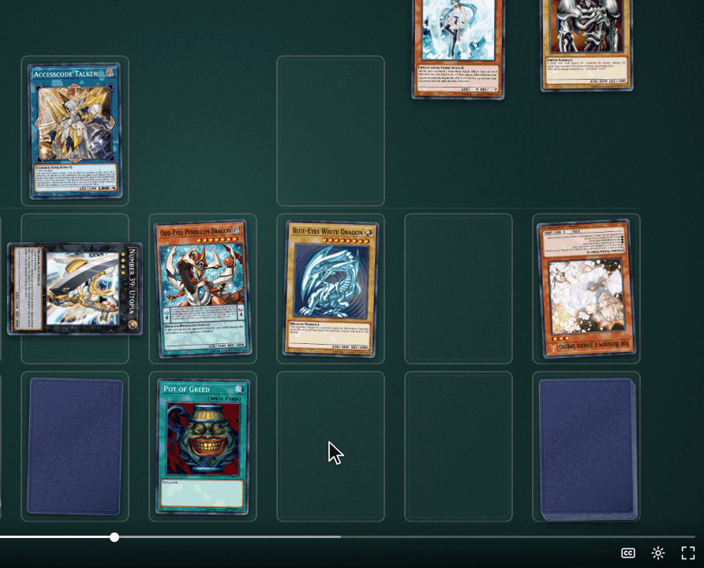

### Read the whole board

Press **B** (or **Read all cards** on the bar) while cards are outlined, and Duel Lens reads every one
of them in turn, through the same quick peek as hovering: a card already read (by a preview or a click)
isn't read again. The bar shows "Reading 5 of 12…" while it works; **Esc**, or the **Stop** button that
replaces "Read all cards", ends the run early without sending anything.

When it's done, Chrome's side panel opens on a **Board** view: one list of the cards, each with a small
picture, its name and how sure the match is. Click a row to see that card in full, with a button back to
the board; a **Board | Scans** toggle switches to your usual scan history. The board itself is never added to your history.

  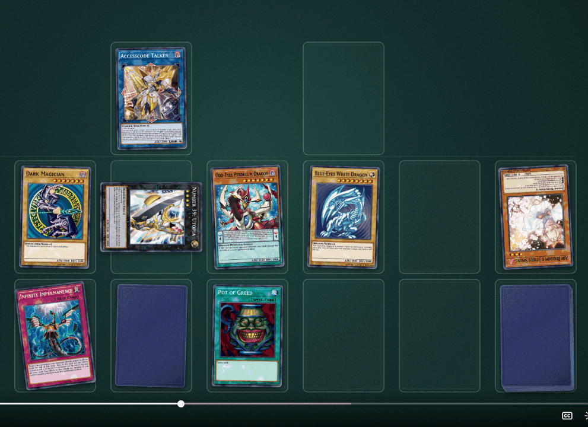

### Optional: ask Claude for a second opinion

Off by default. In Duel Lens's **Options → AI check**, turn on **Offer to ask Claude when a match is
unsure**, allow access to api.anthropic.com when Chrome asks, paste your own Anthropic API key and press
**Test**. An **Ask AI** button then appears on unsure matches, in the card's full details (a preview never
asks).

Only when you press **Ask AI** does Duel Lens send something: the cropped image of that card and up to
five candidate card names, with your key, to Anthropic (api.anthropic.com). Anthropic bills each check
to your key, usually about 1 to 2 US cents with Claude Opus 5 and less with Claude Sonnet 5. Your key
stays in this browser and is sent only to Anthropic. Turning the check off takes the permission back.

  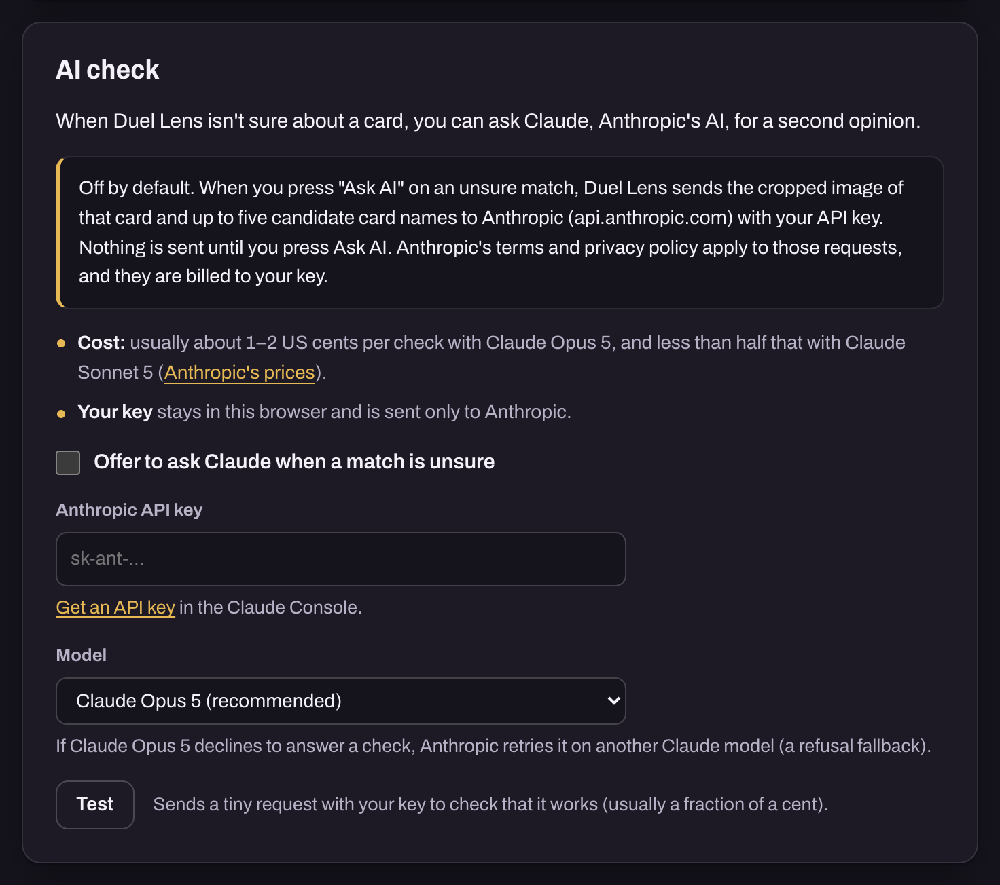

## Tips for good matches

- **Scan a clear moment.** Pause where the card is still and sharp, then press the shortcut: hands
  moving, the camera panning and motion blur all hurt.
- **Use 720p or higher** (on YouTube: the gear icon, then Quality). When a match is unsure on a video of
  480p or lower, Duel Lens says "Raise the video quality for a better match".
- **Wait for the glare to pass.** Foil and sleeve reflections can hide the artwork; a frame or two later
  often reads fine.
- **Box just the artwork** when the rest of the card is covered or hard to see.
- **On pictures and deck lists** (not videos), a bigger card helps: zoom in, or use theater mode or
  fullscreen.

## Privacy in brief

- **Recognition runs on your computer.** The screenshot and the cards you pick or point at are matched by
  Duel Lens's own models in your browser, and aren't uploaded anywhere.
- **No account, no ads, no analytics.** Duel Lens's only server is its report service, which receives a card report only when you press Report issue and then Send report.
- **A manual install** (from a release zip) asks GitHub once a day for the number of the latest version, so it
  can tell you when to update. Nothing about you goes with it, and Options can turn it off. Store installs
  never ask: the store updates them.
- **YGOPRODeck** ([ygoprodeck.com](https://ygoprodeck.com/)) supplies the card data (checked for new
  cards once a week), the card pictures (each downloaded the first time Duel Lens shows it, then cached),
  new cards' artwork, so Duel Lens can recognise them too, and the card text in another language if you
  pick one. These requests carry nothing from your
  screen, but like any website, YGOPRODeck sees your IP address and which card pictures your browser
  asks for.
- **Live check** reads only where your pointer rests, on your computer, while it is on: a video's frames, or a
  picture's pixels (or a screenshot of the visible tab when the page doesn't allow that). It keeps them in memory
  only, drops them once read and sends nothing anywhere. Its list lasts until the tab closes and is not your history.
- **Anthropic** receives a card image and up to five card names only if you turn on the AI check and
  press Ask AI.
- **Your history** (the card, the page's address and title, the time and the video time) stays in this
  browser. Only the cards you click or box are recorded, not the ones you preview. Clear it in the side
  panel; uninstalling Duel Lens removes everything it stored.

Read the full [privacy policy](docs/release/privacy-policy.md). Duel Lens carries a copy too: Options →
About → Privacy policy.

## Languages

- **The interface** (scan bar, card box, side panel, Options, welcome page) follows Chrome's own language:
  English, French, German, Italian, Japanese, Korean, Brazilian Portuguese, Spanish or Simplified Chinese,
  else English. To use another one, pick it in Options → Interface language; the card text keeps its own
  choice. The extension's name in the browser's own menus and the browser's shortcuts page stay in the
  browser's language. The translations are machine-drafted and still await review by native speakers. The
  privacy policy and the licences stay in English.
- **Card names and text** are a separate choice: Options → Card text language (English, French, German,
  Italian, Portuguese, Japanese or Korean). The English name stays under a translated one.
- **No Spanish or Chinese card text yet.** YGOPRODeck, where the card text comes from, offers no Spanish or
  Chinese list, and the only other source (a fan mirror of Konami's database) asks apps not to download its
  whole database. Those cards show in English, while the interface itself is translated.

## Known limitations

- **Full-card foil and overframe prints** (Starlight Rare, Collector's Rare, overframe art): the foil or the
  art spread over the whole card looks unlike the standard card image, so some aren't recognised, or
  get a wrong "Low match" list.
- **Stacked and covered cards:** in a pile of overlapping cards, a click on the top card reads it, but the
  cards under it usually get no outline. A card partly covered by a hand or another card doesn't get the
  second try that cut-off cards do: expect "Not sure" or "Low match" at best, and under another card,
  that guess can be the card on top. Wait for a clearer frame, or box just the visible artwork.
- **Very small or very blurry cards:** expect "Not sure" or no match.
- **Cards outside YGOPRODeck's database** (anime-only cards, custom cards, proxies) and Speed Duel Skill
  cards can't be identified. A brand-new card is recognised once its artwork is on YGOPRODeck (Duel Lens
  downloads new artwork by itself), usually within about a day or a week of release. Alternate artworks
  that YGOPRODeck has no picture of are recognised too, for 267 official artworks printed in the TCG
  (such as Ash Blossom & Joyous Spring's third); the card box then shows the card's usual picture.
- **Some pages are off-limits:** DRM-protected players ("This video blocks screenshots"), the browser's own
  pages and its add-on store (the Chrome Web Store, addons.mozilla.org).
- **No Spanish or Chinese card text** (see [Languages](#languages)).

Duel Lens can misidentify cards, and its card data can be out of date, including banlist status. Check
the card itself or the official Yu-Gi-Oh! card database before relying on it in a game, a trade or a
tournament.

## Credits and legal

- **Card data and images** come from [YGOPRODeck](https://ygoprodeck.com/), which is not affiliated with
  Duel Lens. Thanks to YGOPRODeck for the Yu-Gi-Oh! API.
- **Third-party code, models and fonts,** and their licences:
  [THIRD_PARTY_NOTICES.md](THIRD_PARTY_NOTICES.md).
- **Claude and Anthropic** are trademarks of Anthropic, PBC. Duel Lens is not affiliated with Anthropic.

Duel Lens is an unofficial fan tool, not affiliated with or endorsed by Konami.

Duel Lens is an unofficial, fan-made tool for the Yu-Gi-Oh! TRADING CARD GAME. It is not produced,
sponsored, endorsed or approved by, or affiliated with, Konami Digital Entertainment, Konami Group
Corporation or their affiliates, Studio Dice, Shueisha or TV Tokyo. Yu-Gi-Oh!, KONAMI and the names,
text and images of Yu-Gi-Oh! cards are trademarks and copyrights of their respective owners (© Studio
Dice/SHUEISHA, TV TOKYO, KONAMI). Card data and card images come from YGOPRODeck (ygoprodeck.com), which is
not affiliated with Duel Lens either.

## Report a problem

A card read wrong, or not read at all? Press **Report issue** in its card box: it sends the card's picture
and what Duel Lens said, with no account needed (see [Report a wrong card](#report-a-wrong-card)).

Something else that doesn't work? [Open an issue](https://github.com/mathulbrich/duel-lens/issues) with
the video (and the time) or the page, what you clicked or boxed, and what the card box said.

## For developers

Building from source, the models, the data, the tests and cutting a release:
[docs/DEVELOPMENT.md](docs/DEVELOPMENT.md). The pictures in this README are made by
[tools/readme-media](tools/readme-media/README.md).

## License

Duel Lens is licensed under the [Apache License, Version 2.0](LICENSE). Copyright 2026 the Duel Lens
authors. Third-party components keep their own licences:
[THIRD_PARTY_NOTICES.md](THIRD_PARTY_NOTICES.md).
